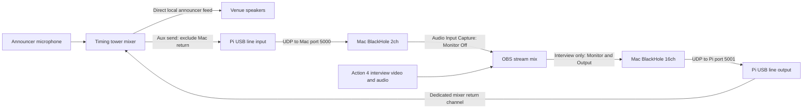

# Audio routing

## Routes that must never feed each other

- **Tower input in OBS must not be monitored to BlackHole 16ch.** Keep `Tower announcer` on Monitor Off. Otherwise the announcer returns to the PA with delay.
- **Mixer Mac-return channel must not feed the aux send going to the Pi.** Otherwise the interview loops through the network repeatedly.
- **Do not use one BlackHole device for both directions.** BlackHole 2ch is the incoming tower bus; BlackHole 16ch is the outgoing interview bus.
- Do not duplicate either bus through OBS global audio sources, desktop capture or an aggregate device that mixes both routes.

Both network directions may remain running continuously when these mix-minus exclusions are in place. The software cannot inspect the mixer's wiring or OBS routing and cannot automatically enforce these exclusions.

Use a mixer aux send that can exclude the return channel. A headphone/main mix containing the return audio is not a safe substitute. If the mixer cannot create this separate send, stop and change the routing before enabling both directions.

## Interview operation

The announcer continues to reach the PA directly through the mixer. The interview microphone arrives with the camera stream in OBS. Enable its Monitor and Output route when the interview should reach both YouTube and the PA. Disable/mute that source when leaving the interview scene; test actual scene behavior, including nested/shared sources.

Keep the interview microphone away from PA speakers and start at low volume. Acoustic feedback can occur even when digital mix-minus routing is correct.

## Delay and sync

This project transports audio; it does not synchronize the Action 4 camera or control OBS scenes. The camera's RTMP delay remains. Sending its audio back to the PA adds network and playback delay. The direct announcer-to-PA path avoids that round trip.

Measure the stream's picture/audio sync with a visible clap and adjust OBS where necessary. PA delay and stream lip sync are separate checks. Do not add delay to the direct announcer PA path just to align the stream.
